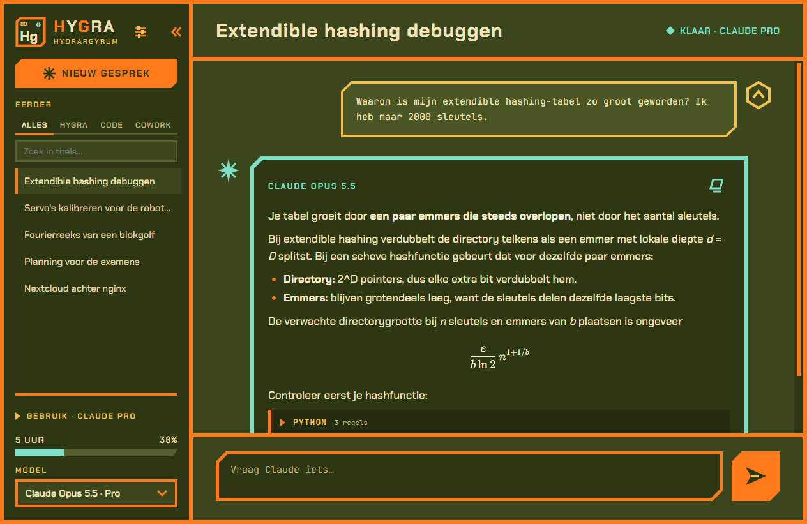
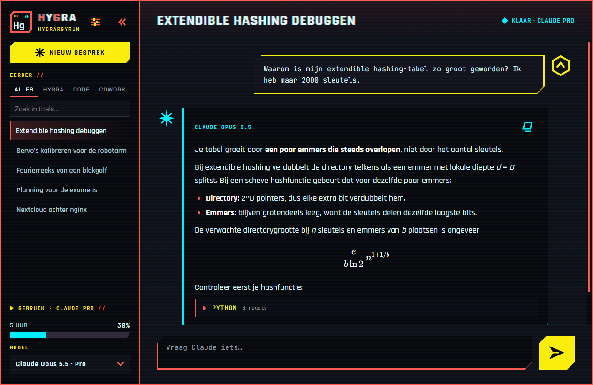
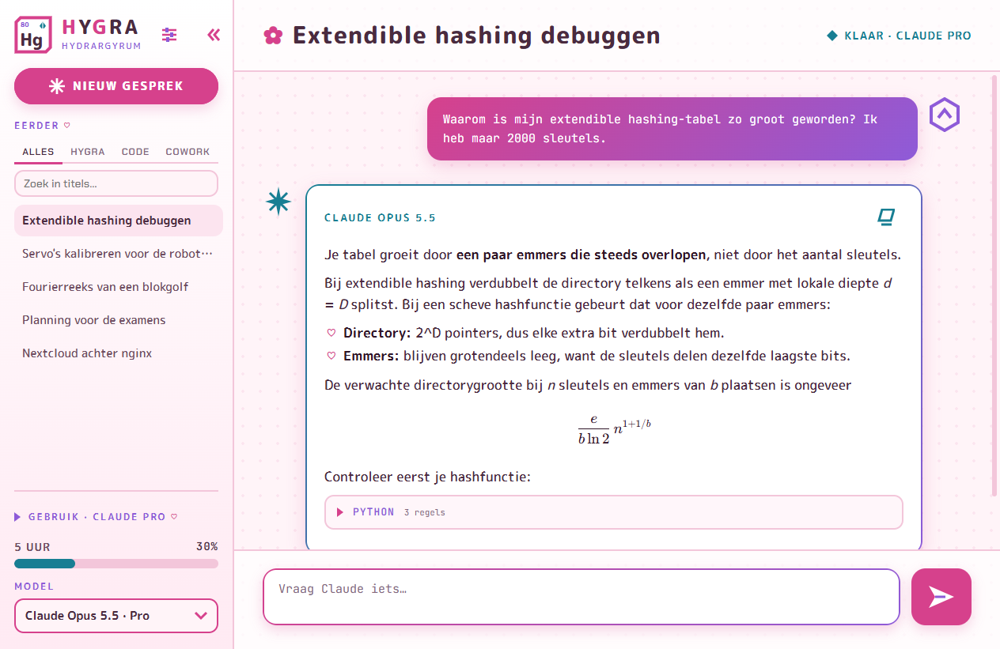
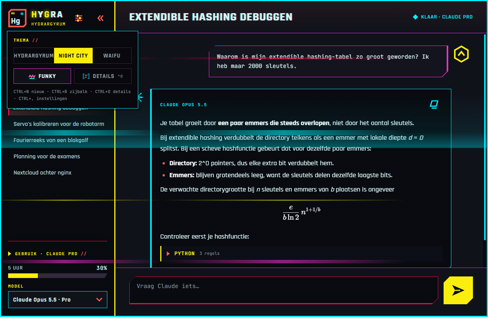

# HyGra


**A desktop app for Claude on Windows: the full power of Claude Code, in a chat window you actually want to look at.**

HyGra (from *HydrarGyrum*, Hg, element 80) runs **Claude Opus 5.5** through Claude Code on your own Claude Pro/Max subscription. No API key and no extra cost. It also has three themes, a funky mode, and a GPU experiment inside.



## Why HyGra

- **Claude Code, not a lighter chatbot.** Every chat is a real Claude Code session: all tools, your own settings, `CLAUDE.md` and MCP servers. Tool calls show up as small lines in the reply.
- **Fast.** Each chat keeps a warm Claude Code process ready, so a short reply starts in about 2.5 s instead of 6.5 s.
- **Several chats at once.** Every chat runs its own reply in parallel. You can switch chat or model while Claude is still writing.
- **Replies survive closing the app.** A reply keeps running when you close HyGra and appears when you open it again.
- **Talk while Claude works.** Type during a reply and Claude takes your message in mid-turn, as in Claude Code. Esc stops it.
- **All your history in one list.** HyGra lists your Claude Code and Cowork sessions next to its own chats, with filters and search. You can continue Code sessions right in HyGra.
- **Remote Control.** Every chat is also a session in the Claude mobile app and on claude.ai/code while a reply runs.
- **See what Claude does.** *Details* (Ctrl+O) opens each tool call to its input and output, and shows Claude's thinking.
- **Readable replies.** Markdown, KaTeX math, code blocks that start collapsed, and file paths you can click to open.
- **Usage at a glance.** Your 5-hour and weekly plan usage, also as a small meter when the sidebar is folded in.
- **Feels native.** A splash screen in your theme, taskbar progress while Claude works, a blinking taskbar button when a reply lands, and a Start-menu shortcut. It works offline: fonts and libraries are bundled.

## Themes

Pick one in the settings panel (the sliders button next to the logo, or **Ctrl+,**).

| HydrarGyrum | Night City | Waifu |
|---|---|---|
|  |  |  |
| Olive, thick angular orange lines, parchment text. The original. | After the Cyberpunk 2077 HUD: red lines, yellow actions, cyan for Claude, chamfered frames, scanlines. | After the Doki Theme: sakura pastel, everything round, hearts and flowers. |

**Funky mode** makes the frames cycle through colors while something runs, in each theme's own style. In HydrarGyrum, Claude surfs across the screen. In Night City, neon colors cut, a scan beam sweeps the window and glitches flash. In Waifu, sakura petals and hearts fall.



**Waifu art is not included.** The theme shows a character on the right side of the chat, but that art belongs to its makers, so it is not in this repo. Put PNGs with a transparent background in `%LOCALAPPDATA%\HyGra\themes\waifu`, for example the transparent wallpapers from the [Doki Theme assets](https://github.com/doki-theme/doki-theme-assets). Each file becomes a character you can choose in the settings panel.

## Keyboard

| Keys | Does |
|---|---|
| Enter / Shift+Enter | Send / new line (while Claude works: send mid-turn) |
| Esc | Stop the reply |
| Ctrl+N | New chat |
| Ctrl+B | Fold the sidebar into a rail |
| Ctrl+O | Details: tool input/output and thinking |
| Ctrl+, | Settings |

## Install

Windows 10/11, Python 3.10–3.13 with [uv](https://docs.astral.sh/uv/), and the [Claude Code](https://claude.com/claude-code) CLI logged in with your Claude subscription (run `claude` once in a terminal).

```powershell
git clone https://github.com/HenriGoudezeune/HyGra
cd HyGra
uv sync
uv run python install_shortcut.py   # icon + Start-menu / desktop shortcut "HyGra"
uv run python app.py                # or start it from the Start menu
```

- **Billing:** chats count toward your plan's normal usage limits. An `ANTHROPIC_API_KEY` in the environment is deliberately ignored, so HyGra never falls back to paid API billing.
- **Full access:** each chat runs Claude Code with `--dangerously-skip-permissions`, as in your own terminal. Claude can read, change and run anything on your computer, so only use HyGra on your own machine.
- **Local models:** the NCM models below need their checkpoints in `ckpt/`. Claude works without them.

## The experiment inside: Next-Concept Modeling on a laptop

HyGra started as an attempt to train a **Next-Concept Model (NCM)** for Python code on a single 4 GB laptop GPU (RTX 3050). You can pick these models in the app and watch them write level by level, from coarse to fine.

Based on *Next-Concept Modeling: Fast, Parallel Coarse-to-Fine Text Generation*
(Kumbong, Khare, Ré et al., Stanford / Hazy Research, arXiv 2610.14162,
[github.com/HazyResearch/ncm](https://github.com/HazyResearch/ncm)).
The official repo ships evaluation code only. This repo is a compact re-implementation with training code.

> **Honest summary:** the concept models here are **fast but not useful**. They produce one 128-token chunk in 73 ms, where plain token-by-token generation takes seconds. But only 1–2% of their output is valid Python. See [Results](#results).

### How NCM works

1. **Tokenizer (stage 1).** A VQ-VAE turns a chunk of 128 BPE tokens into a 64-position latent. A *multiscale residual VQ* quantizes the latent at the scales `1, 2, 4, 8, 16, 32, 48, 64, 64`, from coarse ("what kind of code is this") to fine (exact tokens).
2. **Generator (stage 2).** The generator predicts the next chunk's codes one scale at a time, and all codes of a scale in parallel. A 128-token chunk therefore takes **9 forward passes**, where an autoregressive model needs 128.

This repo has three variants:

| | What | Code |
|---|---|---|
| **NCM 34M** | Generator trained from scratch (block-causal transformer) | `train_generator.py` |
| **Qwen-NCM 0.5B** | Qwen2.5-Coder-0.5B as backbone (LoRA). It reads the text, and concept slots sit at the RoPE positions of the text they summarize | `ncm/qwen_gen.py`, `train_generator_qwen.py` |
| **Context decoder** | A VQ decoder that also reads the previous chunk. The codes are frozen, so it works with both generators | `ncm/context_decoder.py`, `train_decoder.py` |

### Results

Evaluation setup:
- **Hardware:** RTX 3050 Laptop, 4 GB.
- **Data:** 409M tokens of filtered Python from `codeparrot/codeparrot-clean`, with an own 16k BPE vocabulary.
- **Tests:** 16 small function tasks in `eval_code.py`, 5 samples each.

| | NCM 34M | Qwen-NCM 0.5B |
|---|---|---|
| Training | 20k steps × 32 (3.3 h) | 8k steps × 8 (6.5 h) |
| Valid Python (stage-1 decoder) | 1% | 0% |
| Valid Python (context decoder) | 2% | 0% |
| Tests passed (pass@5) | 0 / 14 | 0 / 14 |
| Coarsest level: loss (uniform = 5.55) | 4.61 | 5.45 |
| Finest level: accuracy | 33% | 6% |
| **Time per 128-token chunk** | **73 ms** | 726 ms |

For comparison, Qwen2.5-Coder-0.5B generating token by token took 5203 ms per 128 tokens on the same GPU (`bench_speed.py`).

Stage-1 token reconstruction is 95.7%. The context decoder raises it to 96.5%.

What we learned:
- **Speed:** the speed-up of concept generation is real.
- **Coarse levels:** these are the problem. The generators barely beat the unigram entropy on levels 0–6. Every 128-token chunk is then decoded from a poor "plan", and the output falls apart.
- **Pretrained backbone:** it does *not* fix the coarse levels at this budget. In the same wall-clock time it sees 4× fewer examples, and it ends up worse.
- **Reconstruction errors:** 1 wrong token in about 28 already breaks syntax. Even a perfect generator would need a better tokenizer.

### Training it yourself

```powershell
uv sync                                    # torch with CUDA 12.8
uv run python prepare.py                   # download + filter codeparrot, train BPE -> data/
uv run python train_tokenizer.py           # stage 1      -> ckpt/tokenizer.pt
uv run python train_generator.py           # stage 2      -> ckpt/generator.pt
uv run python train_generator_qwen.py      # stage 2 alt. -> ckpt/generator_qwen.pt
uv run python train_decoder.py             # stage 1b     -> ckpt/decoder_ctx.pt
uv run python eval_code.py --generator ckpt/generator.pt
uv run python diagnose_levels.py --generator ckpt/generator.pt
uv run python bench_speed.py
uv run python generate.py --prompt "def quicksort(arr):`n" --show-levels
```

**GPU temperature:**
- **Pausing:** every training script pauses when the GPU goes above 82 °C, and resumes below 72 °C (`ncm/thermal.py`).
- **Watchdog:** `gpu_watchdog.ps1` logs the temperature and stops training at ≥ 87 °C.

### Checkpoints

The trained weights are attached to the GitHub release:
- `tokenizer.pt`
- `generator.pt`
- `generator_qwen.pt`, which contains only the LoRA adapters and the new layers. The base model is downloaded from Hugging Face.
- `decoder_ctx.pt`

Put them in `ckpt/`. `data/bpe.json` is in the release too.

## Licenses

- **This code:** MIT, see `LICENSE`.
- **Qwen-NCM:** built on [Qwen2.5-Coder-0.5B](https://huggingface.co/Qwen/Qwen2.5-Coder-0.5B) (Apache 2.0).
- **Bundled web libraries and fonts:** marked, DOMPurify and KaTeX (MIT), and the fonts Chakra Petch, JetBrains Mono, Rajdhani and M PLUS Rounded 1c (SIL OFL 1.1); their licenses are in `web/vendor`.
- **Training data:** `codeparrot/codeparrot-clean`. Its source files carry their own licenses, so the data itself is not redistributed here.
